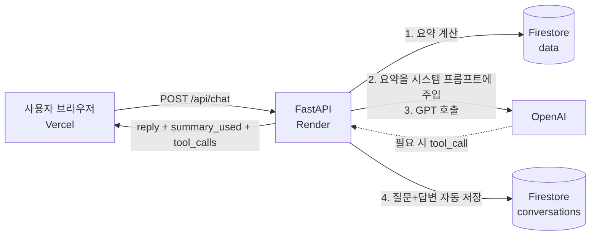
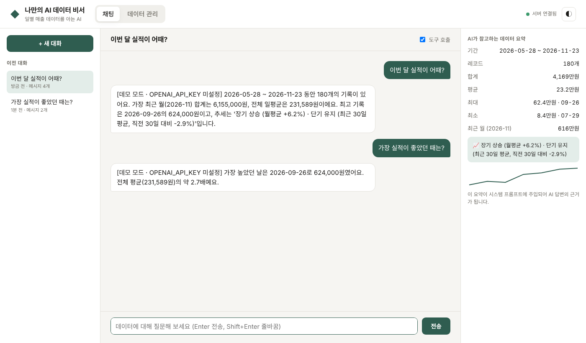
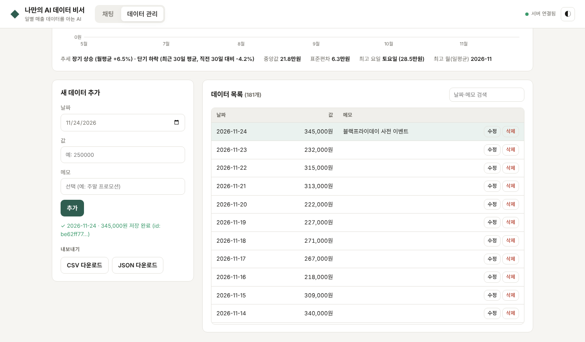
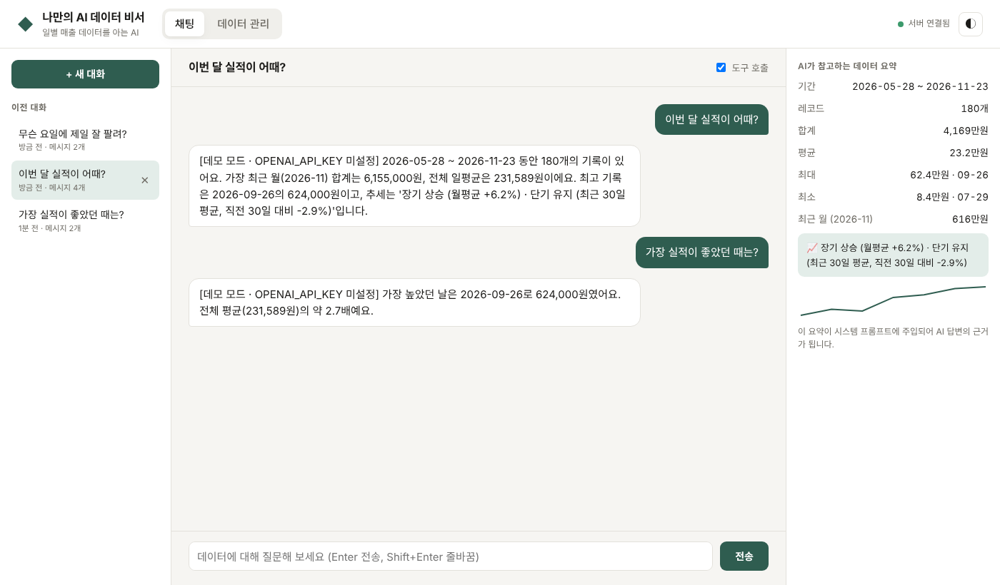

# 나만의 AI 데이터 비서

> 일반 ChatGPT는 내 데이터를 모릅니다. 이 서비스는 **내 시계열 데이터를 분석한 요약을 시스템 프롬프트에 주입**해서,
> "이번 달 실적 어때?" 같은 질문에 **내 숫자를 근거로** 답하는 AI 비서입니다.

| 구분 | URL |
|---|---|
| 프론트엔드 (Vercel) | `https://<your-app>.vercel.app` |
| 백엔드 API (Render) | `https://<your-api>.onrender.com` |
| Swagger UI | `https://<your-api>.onrender.com/docs` |

> ⏱ 백엔드는 Render 무료 플랜이라 15분간 요청이 없으면 잠듭니다. 첫 접속 시 30~60초 걸릴 수 있으며, 화면 상단에 "서버를 깨우는 중" 안내가 표시됩니다.

---

## 1. 주요 기능

| 기능 | 설명 |
|---|---|
| 데이터 기반 AI 채팅 | 데이터 요약을 시스템 프롬프트에 주입 → GPT 답변. 응답 대기 중 로딩 표시. 대화는 자동 저장 |
| 데이터 관리 (CRUD) | `(date, value, memo)` 추가·수정·삭제, 목록 검색, 저장 결과 메시지 |
| 대화 기록 | 이전 대화 목록, 클릭하면 전체 메시지 불러오기, 삭제 |
| 데이터 요약 | 기간·개수·합계/평균/최대/최소·장단기 추세·월별 요약 표시 |
| ⭐ 보너스 | Function Calling(도구 3종), MCP 서버, 확장 통계 API, Canvas 추세 그래프, CSV/JSON 내보내기, 다크 모드 |

## 2. 기술 스택

- **Backend**: Python 3.10+, FastAPI, Pydantic v2, Uvicorn
- **DB**: Firebase Firestore (`firebase-admin`)
- **AI**: OpenAI Chat Completions API (`gpt-4o-mini` 기본, 환경 변수로 변경 가능) + Function Calling
- **Frontend**: HTML / CSS / Vanilla JavaScript (프레임워크·차트 라이브러리 없음, Canvas로 직접 그림)
- **Deploy**: Render (백엔드), Vercel (프론트엔드)
- **Bonus**: MCP Server (`mcp` Python SDK)

## 3. 구조

```
ai-assistant/
├── backend/
│   ├── main.py                     # 앱 생성, CORS, 라우터 등록, 전역 예외 처리
│   ├── app/
│   │   ├── config.py               # 환경 변수 로딩 (키 하드코딩 금지)
│   │   ├── database.py             # Firestore / Memory 저장소 (Repository 패턴)
│   │   ├── schemas.py              # Pydantic 요청·응답 모델 = 입력 검증
│   │   ├── routers/                # HTTP 계층: URL·상태코드·에러 변환만 담당
│   │   │   ├── data.py             # /api/data (CRUD, summary, statistics, export, bulk)
│   │   │   ├── conversations.py    # /api/conversations
│   │   │   └── chat.py             # /api/chat
│   │   └── services/               # 비즈니스 로직: 분석·프롬프트·GPT 호출
│   │       ├── data_service.py     # CRUD + 요약/통계 계산
│   │       ├── conversation_service.py
│   │       └── chat_service.py     # 컨텍스트 주입 + Function Calling
│   ├── data/sample_sales.csv       # 샘플 데이터 180일
│   ├── scripts/
│   │   ├── generate_sample.py      # 샘플 데이터 생성
│   │   └── seed_data.py            # CSV → Firestore 업로드
│   ├── requirements.txt
│   └── .env.example
├── frontend/
│   ├── public/                     # index.html, style.css, app.js, config.js
│   ├── scripts/build-config.js     # Vercel 환경 변수 → config.js 생성
│   ├── package.json
│   └── vercel.json
├── mcp_server/server.py            # [보너스] MCP 서버
└── render.yaml                     # Render Blueprint (선택)
```

**라우터/서비스 분리 기준** — 라우터는 "HTTP를 어떻게 받고 돌려줄지"(경로, 상태 코드, 404 변환)만, 서비스는 "무엇을 계산하고 저장할지"만 안다.
그래서 `build_summary()`를 `/api/data/summary` 라우터와 `/api/chat`의 컨텍스트 주입, GPT 도구 호출이 **똑같이 재사용**한다.
저장소는 `Repository` 인터페이스 뒤에 숨겨서 Firestore ↔ 메모리 저장소를 환경 변수 하나로 바꿀 수 있다.

### 시스템 흐름



## 4. 하루 완성 일정 (참고)

| 시간 | 할 일 | 확인 기준 |
|---|---|---|
| 09:00–10:00 | Firebase 프로젝트·서비스 계정 키, OpenAI 키, Render/Vercel 가입 | 키 2개 확보 |
| 10:00–11:00 | 데이터 선정·CSV 준비(100행 이상), 로컬 메모리 모드로 실행 | `/docs` 열림 |
| 11:00–13:00 | `.env` 설정 → Firestore 모드로 전환, 시드 업로드, CRUD·summary 테스트 | Firestore 콘솔에 데이터 보임 |
| 14:00–15:30 | `/api/chat` 실제 GPT 연결, 프롬프트 다듬기 | 답변에 내 숫자가 등장 |
| 15:30–17:00 | 프론트 로컬 연결 테스트, 디자인 조정 | 4개 화면 동작 |
| 17:00–18:30 | Render → Vercel 순서로 배포, CORS 설정 | 배포 URL에서 채팅 성공 |
| 18:30–19:30 | 스크린샷 3장, README URL 채우기, (선택) 보너스 | 제출 |

## 5. 로컬 실행

### 5-1. 키 없이 화면부터 보기 (메모리 모드)
Firebase·OpenAI 키가 없어도 샘플 데이터 180건이 자동으로 들어가고, AI는 "데모 모드" 답변을 합니다.

```bash
cd backend
python -m venv venv
source venv/bin/activate            # Windows: venv\Scripts\activate
pip install -r requirements.txt
STORAGE_BACKEND=memory uvicorn main:app --reload     # Windows PowerShell: $env:STORAGE_BACKEND="memory"; uvicorn main:app --reload
```

다른 터미널에서:
```bash
cd frontend
npm run dev        # → http://localhost:5500  (또는 VS Code Live Server로 public/index.html 열기)
```

### 5-2. 실제 모드 (Firestore + OpenAI)

1. **Firebase**: [Firebase 콘솔](https://console.firebase.google.com) → 프로젝트 생성 → *Firestore Database* 만들기(프로덕션 모드, 지역 `asia-northeast3` 서울 권장)
2. 프로젝트 설정 → *서비스 계정* → **새 비공개 키 생성** → JSON 다운로드 (⚠️ 절대 Git에 올리지 말 것)
3. `backend/.env.example`을 `backend/.env`로 복사하고 값 채우기

   ```bash
   # JSON 파일을 한 줄 문자열로 만들기
   python -c "import json;print(json.dumps(json.load(open('serviceAccountKey.json'))))"
   ```
   출력 결과를 `FIREBASE_SERVICE_ACCOUNT_JSON=` 뒤에 붙여 넣습니다. (또는 `GOOGLE_APPLICATION_CREDENTIALS=./serviceAccountKey.json`)

4. 데이터 업로드 후 실행
   ```bash
   python -m scripts.seed_data --csv data/sample_sales.csv     # 내 CSV로 교체 가능 (date,value,memo)
   uvicorn main:app --reload
   ```
5. http://localhost:8000/docs 에서 `GET /api/data/summary` → `POST /api/chat` 순서로 테스트

> **내 데이터로 바꾸기**: `date,value,memo` 형식 CSV(100행 이상)를 만들고 `DATA_NAME`(예: `일일 운동 시간`), `DATA_UNIT`(예: `분`)을 바꾸면 프롬프트와 화면 단위가 함께 바뀝니다.

## 6. 환경 변수

### Backend (Render)

| 변수 | 필수 | 설명 | 예시 |
|---|---|---|---|
| `OPENAI_API_KEY` | ✅ | OpenAI API 키 (없으면 데모 모드) | `sk-...` |
| `FIREBASE_SERVICE_ACCOUNT_JSON` | ✅ | 서비스 계정 JSON 전체(한 줄) 또는 base64 | `{"type":"service_account",...}` |
| `ALLOWED_ORIGINS` | ✅ | CORS 허용 도메인, 쉼표 구분. 끝에 `/` 붙이지 말 것 | `https://my-ai.vercel.app,http://localhost:5500` |
| `GOOGLE_APPLICATION_CREDENTIALS` | | JSON 대신 키 파일 경로 사용 시 | `/etc/secrets/serviceAccountKey.json` |
| `OPENAI_MODEL` | | 사용할 모델 | `gpt-4o-mini` |
| `OPENAI_MAX_TOKENS` | | 답변 최대 토큰 (비용 보호) | `500` |
| `CHAT_HISTORY_LIMIT` | | GPT에 함께 보낼 이전 메시지 수 | `10` |
| `DATA_NAME` / `DATA_UNIT` | | 데이터 이름·단위 (프롬프트용) | `일별 매출` / `원` |
| `STORAGE_BACKEND` | | `firestore`(기본) 또는 `memory`(로컬 테스트) | `firestore` |

`ALLOWED_ORIGINS`에 `*.vercel.app`을 넣으면 Vercel 프리뷰 도메인 전체를 허용합니다.

### Frontend (Vercel)

| 변수 | 필수 | 설명 |
|---|---|---|
| `API_BASE_URL` | ✅ | 백엔드 주소 (예: `https://my-ai-api.onrender.com`) |
| `DATA_NAME`, `DATA_UNIT` | | 화면 표시용 |

> 바닐라 JS는 브라우저에서 `process.env`를 못 읽기 때문에, Vercel 빌드 단계(`npm run build`)에서 `scripts/build-config.js`가 `public/config.js`를 생성합니다. **API 주소만** 넣고, 비밀 키는 절대 프론트에 두지 않습니다.

## 7. 배포

### 7-1. 백엔드 → Render
1. 이 저장소를 GitHub에 push (`.env`, 키 JSON이 `.gitignore`에 있는지 확인)
2. Render → **New → Web Service** → 저장소 선택
   - Root Directory: `backend`
   - Runtime: Python 3 / Build: `pip install -r requirements.txt`
   - Start: `uvicorn main:app --host 0.0.0.0 --port $PORT`
   - Instance Type: Free
3. Environment에 위 표의 변수 입력 (`PYTHON_VERSION=3.11.9` 권장). 키 파일 방식을 쓰려면 *Secret Files*에 `serviceAccountKey.json` 업로드 후 `GOOGLE_APPLICATION_CREDENTIALS=/etc/secrets/serviceAccountKey.json`
4. 배포 완료 후 `https://<your-api>.onrender.com/docs` 접속 확인

(또는 루트의 `render.yaml`로 *Blueprint* 배포)

### 7-2. 프론트엔드 → Vercel
1. Vercel → **Add New → Project** → 같은 저장소 선택
2. **Root Directory: `frontend`**, Framework Preset: *Other* (빌드 설정은 `vercel.json`에 있음)
3. Environment Variables에 `API_BASE_URL` 입력 → Deploy
4. 발급된 Vercel 도메인을 Render의 `ALLOWED_ORIGINS`에 추가 → Render 재배포
5. 환경 변수를 바꾼 뒤에는 Vercel도 **Redeploy**해야 `config.js`에 반영됩니다

### 콜드스타트 대응
- 프론트 진입 시 `/health`를 최대 8번 재시도하며 상단 배너로 "서버를 깨우는 중" 안내
- 채팅 응답이 8초 넘게 걸리면 로딩 문구가 "서버가 깨어나는 중일 수 있어요"로 바뀜
- (선택) [UptimeRobot](https://uptimerobot.com) 등으로 `/health`를 주기적으로 호출하면 잠들지 않음

## 8. API 명세

| Method | Path | 설명 |
|---|---|---|
| POST | `/api/data` | 데이터 추가 `{date, value, memo}` |
| GET | `/api/data?start=&end=` | 목록 조회 (날짜 오름차순, 기간 필터 선택) |
| PUT | `/api/data/{id}` | 수정 (보낸 필드만 변경, 최소 1개 필수) |
| DELETE | `/api/data/{id}` | 삭제 (204) |
| GET | `/api/data/summary` | **프롬프트 주입용 요약** |
| GET | `/api/data/statistics` | ⭐ 확장 통계 (중앙값, 표준편차, 7일 이동평균, 요일별 평균, 전월 대비) |
| GET | `/api/data/export?format=csv\|json` | ⭐ 내보내기 |
| POST | `/api/data/bulk` | 여러 건 한 번에 추가 (초기 업로드용) |
| POST | `/api/conversations` | 대화 저장 `{title, messages[]}` |
| GET | `/api/conversations` | 대화 목록 — **messages 미포함** (id, title, message_count, preview, 시간) |
| GET | `/api/conversations/{id}` | 특정 대화 **전체 messages** 조회 (요구사항 A안) |
| DELETE | `/api/conversations/{id}` | 대화 삭제 |
| POST | `/api/chat` | AI 대화 `{message, conversation_id?, use_tools?}` → `{reply, conversation_id, summary_used, tool_calls}` |
| GET | `/health` | 헬스 체크 |

요약 응답 예시:
```json
{
  "period": "2026-05-28 ~ 2026-11-23",
  "count": 180,
  "metrics": { "total": 41686000, "average": 231589, "max": 624000, "max_date": "2026-09-26", "min": 84000, "min_date": "2026-07-29" },
  "trend": "장기 상승 (월평균 +6.2%) · 단기 유지 (최근 30일 평균, 직전 30일 대비 -2.9%)",
  "monthly": [{ "month": "2026-11", "total": 6155000, "average": 267609, "days": 23 }],
  "recent": [{ "id": "...", "date": "2026-11-23", "value": 232000, "memo": "" }]
}
```

### Firestore 컬렉션 구조
```
data/{autoId}           date: "2026-11-23", value: 232000, memo: "", created_at, updated_at
conversations/{autoId}  title, created_at, updated_at,
                        messages: [{ role: "user"|"assistant", content, created_at }]
```
날짜는 ISO 문자열로 저장해 문자열 정렬 = 시간 정렬이 되도록 했습니다. 대화는 메시지 수가 많지 않아 문서 하나의 배열에 담았습니다(Firestore 문서 1MB 제한 내).

## 9. 핵심 개념 정리

**① 시계열 분석 → 요약 → 서비스 활용** — 원본 180행을 매번 GPT에 보내면 비싸고 느립니다. 서버가 합계·평균·최대/최소·월별 집계·추세(최근 30일 vs 직전 30일, 월별 일평균의 평균 증감률)를 미리 계산해 **수십 줄의 요약**으로 압축하고, 이 요약을 화면 표시·프롬프트 주입·도구 응답에 공통으로 씁니다.

**② 컨텍스트 주입** — GPT는 학습 후에 생긴 내 데이터를 모릅니다. 그래서 매 요청마다 시스템 프롬프트에 `[사용자 데이터 요약]` 블록을 넣어 "이 숫자를 근거로 답하라"고 지시합니다. 데이터가 바뀌면 다음 질문부터 자동으로 새 요약이 들어갑니다(`chat_service.build_system_prompt`).

**③ Pydantic 검증** — `DataCreate`는 날짜 형식, `value ≥ 0`, 메모 200자, 미래 날짜 금지를 검사하고, `DataUpdate`는 빈 수정 요청을 막습니다. 잘못된 요청은 서비스 로직과 DB에 닿기 전에 422로 거절되고, 같은 스키마가 Swagger 문서도 자동으로 만듭니다.

**④ CORS / 환경 변수 / 키 관리** — 프론트(vercel.app)와 백엔드(onrender.com)는 출처가 달라 브라우저가 기본적으로 요청을 막습니다. `ALLOWED_ORIGINS`로 내 프론트만 허용합니다. 키를 코드에 넣으면 GitHub에 공개되는 순간 도용·과금 위험이 있으므로 Render 환경 변수에만 두고, 프론트에는 공개해도 되는 API 주소만 둡니다.

## 10. ⭐ 보너스: Function Calling + MCP

### Function Calling
요약만으로 답할 수 없는 질문(특정 주간의 일별 값, 요일별 패턴 등)에서 GPT가 스스로 도구를 호출합니다. 각 도구는 `reason` 인자를 필수로 받아 **"왜 이 도구를 불렀는지"**를 GPT가 직접 기록하고, 응답의 `tool_calls`와 채팅 화면에 표시됩니다.

| 도구 | 언제 호출되나 (근거) | 내부 동작 |
|---|---|---|
| `get_data_by_period(start, end)` | "지난주 매일 매출 보여줘", "추석 연휴 기간 어땠어?" — 요약에 일별 값이 없음 | `data_service.list_data(start, end)` |
| `get_statistics()` | "무슨 요일이 잘 팔려?", "변동성 커?" — 요일별 평균·표준편차는 요약에 없음 | `data_service.build_statistics()` |
| `list_past_conversations()` | "지난번에 내가 뭐 물어봤지?" | `conversation_service.list_conversations()` |

```
사용자 질문
  → [서버] 요약 계산 + 시스템 프롬프트 주입 + tools 스키마 첨부 → GPT
  → GPT: tool_calls = get_statistics(reason="요일별 평균이 필요")
  → [서버] 도구 실행 → 결과를 role=tool 메시지로 추가 → GPT 재호출 (최대 3회)
  → GPT 최종 답변 → 저장 → 화면에 답변 + "🔧 호출한 도구" 표시
```

### MCP 서버 (외부 채널 연동)
같은 기능을 Claude Desktop 같은 MCP 클라이언트에서 호출할 수 있습니다. 배포된 API를 감싸므로 이 서버에는 키가 필요 없습니다.

```bash
pip install "mcp>=1.2"
API_BASE_URL=https://<your-api>.onrender.com python mcp_server/server.py
```

Claude Desktop `claude_desktop_config.json`:
```json
{
  "mcpServers": {
    "ai-data-assistant": {
      "command": "python",
      "args": ["/절대경로/ai-assistant/mcp_server/server.py"],
      "env": { "API_BASE_URL": "https://<your-api>.onrender.com" }
    }
  }
}
```
노출 도구: `get_data_summary`, `get_data_by_period`, `get_statistics`, `list_conversations`.
검증 예: Claude Desktop에서 "내 매출 데이터에서 11월 20~22일 값 알려줘" → `get_data_by_period` 호출 확인.

## 11. 비용·보안 체크리스트

- [x] `OPENAI_MAX_TOKENS=500`, 이전 대화는 최근 10개만 전송, 도구 호출 최대 3회
- [x] 키 없으면 데모 모드로 동작 → 화면 개발 중에는 과금 없음
- [x] `.env`, 서비스 계정 JSON은 `.gitignore` 처리
- [x] 입력 검증(Pydantic) + 404/422/502 에러 메시지 + 전역 500 핸들러
- [ ] OpenAI 대시보드에서 월 사용 한도(Usage limit) 설정 권장
- [ ] Firestore 보안 규칙: 서버(Admin SDK)만 접근하므로 클라이언트 접근은 전부 차단 (`allow read, write: if false;`)

## 12. 제출 스크린샷

> 배포 후 실제 화면으로 교체하세요. (`docs/screenshots/`의 예시는 로컬 데모 모드 화면)

| 데이터 요약이 보이는 채팅 화면 | 데이터 관리 (추가 동작) | 대화 기록 (불러오기) |
|---|---|---|
|  |  |  |
